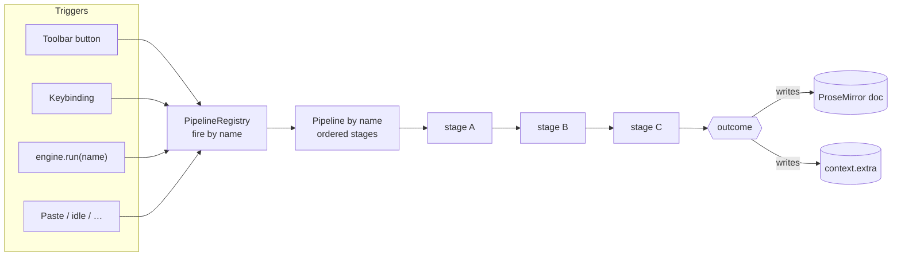

# Pipelines

The **pipeline layer** is how `@keenmate/web-editor` runs *everything a user can
trigger* — a toolbar button, a keybinding, a programmatic `engine.run(name)`, a
paste, an idle derivation. Each is a **named pipeline**: an ordered chain of
**stages** that thread a shared **context** and decide, step by step, what happens
to the document.

> These docs describe the **shipped** engine (`src/engine/pipeline/`). The
> phase-based ordering and the config cell in
> [extensibility.md](./extensibility.md#phases--the-config-cell-design-stage) are
> **design-stage** (prototyped, not yet in the engine); they're flagged inline and
> described in full in the root [`PIPELINES.md`](../../PIPELINES.md) design note.

## The mental model

Every trigger resolves to a **name**, the registry looks up the pipeline of that
name and runs its stages in order. Stages never mutate shared state directly —
each returns an **outcome** (merge data, stop, or skip) and the runner threads the
updated context into the next stage. The only way a stage changes the document is
through an explicit **write port** (`rt.dispatch` / `rt.runCommand`).

## Commands ARE pipelines

There is no separate "command" execution path. Every command auto-wraps into a
trivial one-stage **sync** pipeline named by its id, so a button, a keybinding, and
`engine.run('bold')` all go through the exact same registry. The payoff: *anything
triggerable is extensible the same way* — a plugin can splice a stage into
`bold` exactly as it would into `image:browser:pick`. See
[execution.md](./execution.md).

## Read in this order

1. **[concepts.md](./concepts.md)** — the four primitives: context, stage,
   outcome, pipeline (and the write port a stage uses to touch the document).
2. **[execution.md](./execution.md)** — how pipelines actually run: commands-as-
   pipelines, the registry, `sync` vs `deferred` timing, the async machinery
   (abort / supersede / loader threshold / surface lock), and the interaction host.
3. **[extensibility.md](./extensibility.md)** — how plugins contribute and reshape
   pipelines: anchored stage contributions (shipped), and the phase model + config
   cell + API wrappers (design-stage).

## At a glance — the public surface

| Member | What it does |
| --- | --- |
| `engine.run(name)` | Fire a pipeline by name. Sync → returns whether it resolved; deferred → kicks off and returns `true`. |
| `engine.pipelines` | The `PipelineRegistry` — `has` / `get` / `names` / `on(name, listener)`. |
| `engine.pipelines.on(name, fn)` | Subscribe to a run's `start` / `stage` / `status` / `result` events. Returns an unsubscribe fn. |
| `engine.setInteractionHost(host)` | Provide the modal UI for interactive (dialog) stages. |
| `'lock'` event | Emitted when a gating run locks/unlocks the editing surface. |

A plugin contributes via two fields on `definePlugin({ … })`: `pipelines` (declare
new ones) and `stages` (splice stages into any pipeline by anchor).
