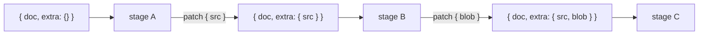
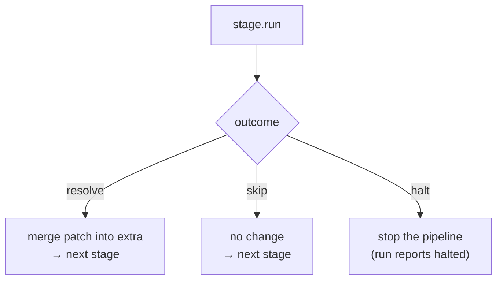
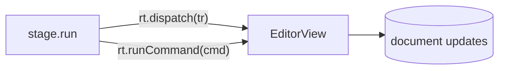

# Concepts

Four primitives make up the pipeline layer: the **context** that flows through a
run, the **stage** that does one unit of work, the **outcome** a stage returns, and
the **pipeline** that names and orders the stages. Plus the **write port** — the
one way a stage touches the live document.

## Context — what flows through a run

```ts
interface PipelineContext {
  doc: PMNode;                    // the ProseMirror document (read-only to stages)
  extra: Record<string, unknown>; // derived / attached data, OUTSIDE the text
}
```

`extra` is the **blackboard**: stages read and write named keys on it, and that's
how one stage hands data to the next without importing it. A stage never mutates
the context in place — the runner builds the next context from the previous one.



## Stage — one unit of work

```ts
interface PipelineStage {
  id: string;
  run: (ctx: PipelineContext, rt: StageRuntime) => StageOutcome | Promise<StageOutcome>;
  interactive?: boolean; // opens a modal — allowed only in deferred pipelines
}
```

A stage reads the context, does its work (sync or async), and returns an
**outcome**. Stages run **sequentially** — a true pipe — each seeing the previous
one's merged `extra`.

## Outcome — resolve, halt, or skip

```ts
type StageOutcome =
  | { action: 'resolve'; patch?: Record<string, unknown> } // merge patch → extra, continue
  | { action: 'halt'; reason?: string }                    // stop the chain
  | { action: 'skip' };                                    // continue unchanged
```



- **resolve** — the normal path; an optional `patch` is shallow-merged into
  `extra`.
- **skip** — this stage had nothing to do (e.g. no image in the selection); the
  chain continues unchanged.
- **halt** — stop here (a blocked paste, a cancelled dialog). The run reports
  `halted` with the reason; downstream stages don't run.

## Pipeline — named, timed, ordered

```ts
interface Pipeline {
  name: string;          // "bold" | "image:browser:pick" | "paste" | …
  timing: 'sync' | 'deferred';
  stages: PipelineStage[];
  policy?: { debounceMs?: number; thresholdMs?: number; lock?: boolean };
}
```

`timing` is the load-bearing distinction (see
[execution.md](./execution.md#sync-vs-deferred)): `sync` pipelines ride the
browser's synchronous events and cannot await; `deferred` pipelines get the full
async machinery. `policy` only applies to deferred pipelines.

## The write port — how a stage touches the document

Stages receive a **runtime** alongside the context. Besides the async controls, it
carries the **write port** — the only way a stage changes the live document:

```ts
interface StageRuntime {
  signal: AbortSignal;   // aborted when a newer run supersedes this one
  ui: InteractionHost;   // host-provided modal bridge (interactive stages)
  generation: number;    // monotonic run id (stale results are dropped)
  // write port (present on engine-run pipelines):
  view?: EditorView;                          // read view.state / schema
  dispatch?: (tr: Transaction) => void;       // apply a transaction
  runCommand?: (cmd: Command) => boolean;     // run a ProseMirror command
}
```



Why a port instead of mutating `ctx.doc`? Because the document is owned by the live
`EditorView`; writing through `dispatch` / `runCommand` keeps ProseMirror's state
authoritative. `ctx.doc` is a **read-only snapshot** stages derive from; the port
is how they write back. (A pure unit run omits the port — a stage that writes must
tolerate its absence.)

Next: **[execution.md](./execution.md)** — how these run, and the sync/deferred split.
