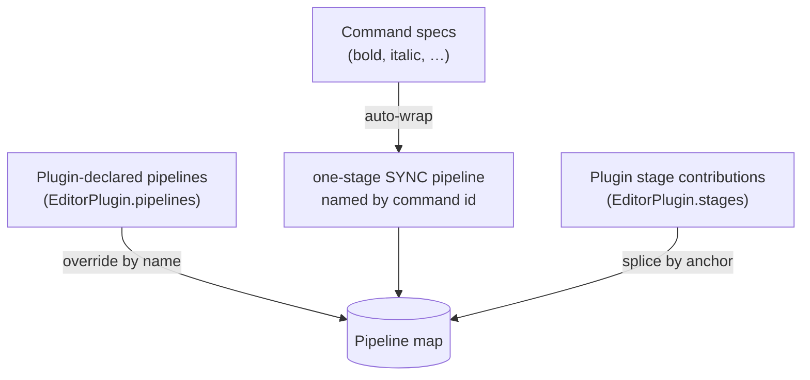
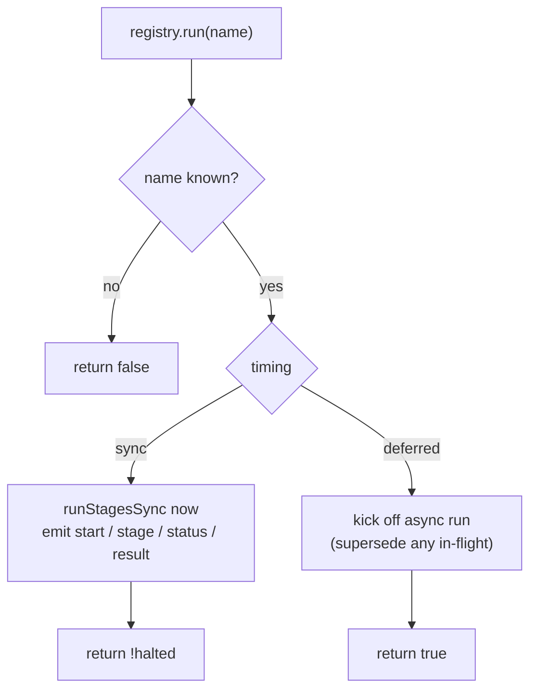
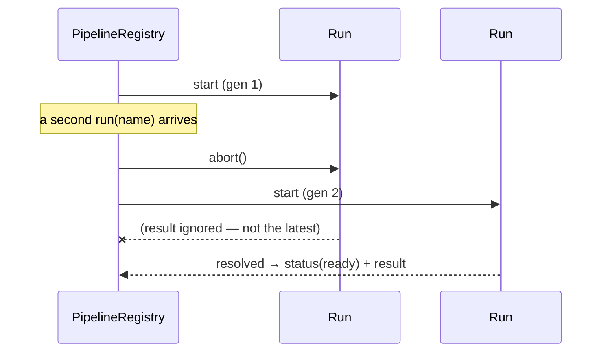
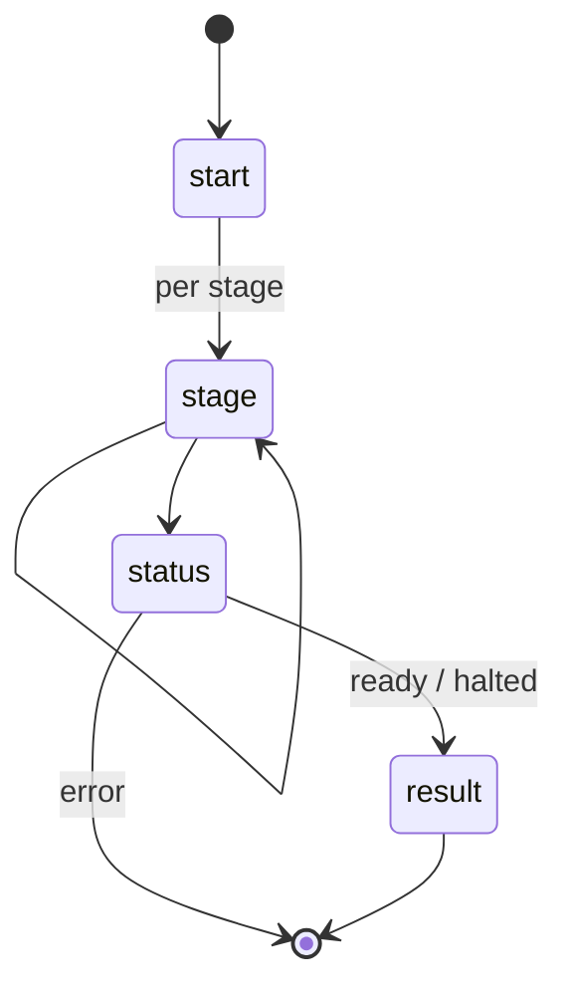

# Execution

How pipelines actually run: the "commands ARE pipelines" unification, the registry
that fires them, the `sync` vs `deferred` split, and the async machinery (abort /
supersede / loader threshold / surface lock) plus the interaction host.

## Commands ARE pipelines

The engine assembles **one** pipeline map from the plugin set. Three layers, in
order:



1. **Every command auto-wraps** into a trivial one-stage `sync` pipeline whose
   single stage runs the ProseMirror command via `rt.runCommand`. A `false` return
   (command not applicable) **halts**, so a keymap binding falls through correctly.
2. **Declared pipelines** are added; a matching name overrides a command wrapper
   (last plugin wins).
3. **Stage contributions** are spliced in by anchor (see
   [extensibility.md](./extensibility.md)).

So a toolbar button, a right-click menu entry, a keybinding, and
`engine.run('bold')` **all** route through the registry to the same named
pipeline. Overhead for the trivial case is ~nil (no promise, no timer), so making
everything a pipeline costs nothing until a pipeline actually uses the async
machinery.

## Firing a pipeline

`engine.run(name)` delegates to `PipelineRegistry.run(name)`:



- **sync** returns whether the run **resolved** (`!halted`). That boolean is what
  lets a keymap binding "fall through" when a command doesn't apply.
- **deferred** returns `true` immediately and runs in the background.

## Sync vs deferred

| | **sync** | **deferred** |
| --- | --- | --- |
| Rides | the browser's synchronous events (paste / copy / keydown) | a background trigger (a command action, idle) |
| Can `await`? | no — stages must return an outcome directly | yes |
| Interactive (modal) stages | ❌ throws at assembly | ✅ allowed |
| Machinery | none | abort / supersede, loader threshold, optional surface lock |
| Returns | `!halted` (keybinding-safe) | `true` (fire-and-forget) |

A stage that returns a Promise, or an `interactive` stage, inside a **sync**
pipeline throws — the browser's synchronous clipboard/key events cannot pause for
an awaited result or a modal.

## The deferred run, step by step

A deferred run gets a monotonic **generation** and an **AbortController**. Firing
the same name again **supersedes** the in-flight run (aborts its `fetch`es, closes
its modal); a superseded run's result is dropped silently. If the run outlives the
**loader threshold** (default 200 ms) it surfaces a `pending` status — so a fast
run shows no spinner. A pipeline with `policy.lock` **locks the surface** (a true
`setEditable(false)`) for the whole run.

```mermaid
sequenceDiagram
  participant U as Trigger
  participant R as PipelineRegistry
  participant P as Stages
  participant H as InteractionHost
  participant V as EditorView

  U->>R: run("image:browser:pick")
  R->>R: new generation + AbortController
  R->>V: setLock(true)  (policy.lock)
  R-->>U: emit start
  R->>P: run stages (signal, ui, generation, write port)
  Note over P,H: interactive stage pauses here
  P->>H: rt.ui.request(cloud-picker)
  H-->>P: { value } or { cancelled }
  P->>P: upload (await; honors signal)
  P->>V: rt.dispatch(insert image)
  P-->>R: resolved
  R->>V: setLock(false)
  R-->>U: emit status(ready) + result
```

If a **newer** run starts mid-flight:



## Observing a run

Subscribe per name; you get the run's lifecycle events (this drives the dev
visualizer and any progress UI):

```ts
const off = engine.pipelines.on('image:browser:pick', (event) => {
  switch (event.type) {
    case 'start':  /* reset step UI (event.generation) */ break;
    case 'stage':  /* event.report: { stageId, phase } — running|ok|skipped|halted|error|aborted */ break;
    case 'status': /* event.status.phase — pending|ready|halted|error */ break;
    case 'result': /* event.context — final { doc, extra } */ break;
  }
});
// …later: off();
```



## The interaction host

Interactive stages are headless — the engine calls the host and awaits; the host
renders whatever UI it likes and resolves:

```ts
interface InteractionHost {
  request(req: InteractionRequest, signal: AbortSignal): Promise<InteractionResult>;
}
```

The default host routes through `window.confirm`. Provide a richer one (a cloud
picker, an image editor) with `engine.setInteractionHost(host)`. The host **must**
honor the `signal` — a superseded run closes its open dialog. The awaited promise
**is** the pause: `resolve` folds the result into `extra`, `halt` stops the chain.

## Keybindings

The engine builds its keymap from the same pipelines: each command's `keys` map to
`() => engine.run(id)`. So a keybinding and a toolbar click are indistinguishable
to the system — both fire the named pipeline.

Next: **[extensibility.md](./extensibility.md)** — contributing and reshaping pipelines.
