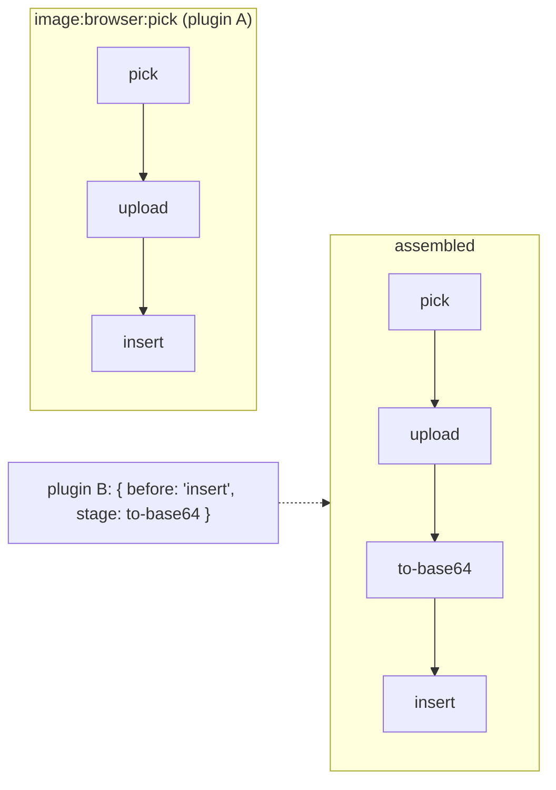
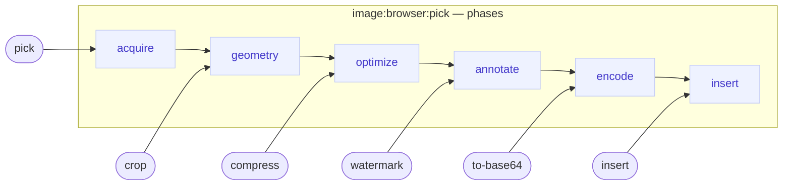
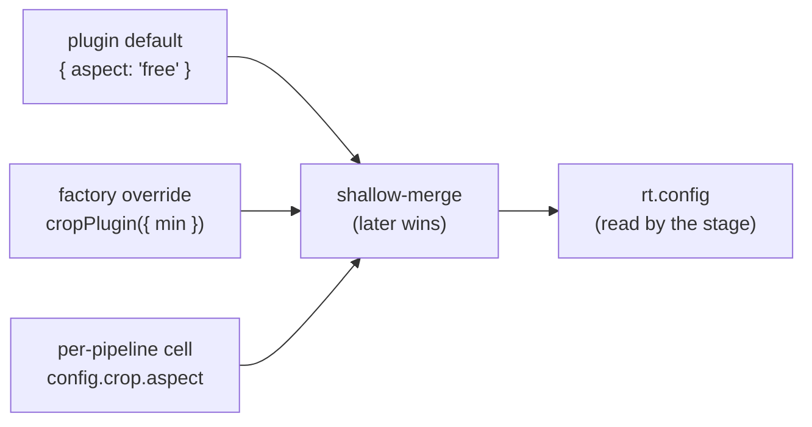
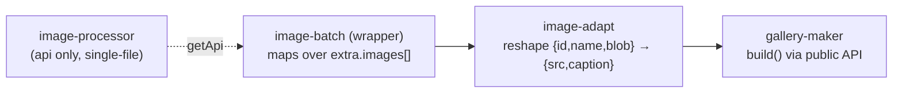

# Extensibility

How plugins contribute and reshape pipelines — without importing each other. This
is the whole point of "commands ARE pipelines": any triggerable action is a named
pipeline a plugin can hook into.

A plugin declares two pipeline-related fields:

```ts
definePlugin({
  name: 'my-plugin',
  pipelines: [ /* declare NEW pipelines */ ],
  stages: { /* splice stages INTO existing pipelines, by name + anchor */ },
});
```

## Anchored stage contributions (shipped)

`EditorPlugin.stages` maps a pipeline **name** to a list of contributions. Each
contribution places a stage relative to the pipeline's existing stages:

```ts
type StageContribution =
  | { stage: PipelineStage; before: string } // insert before an existing stage id
  | { stage: PipelineStage; after: string }  // insert after
  | { stage: PipelineStage }                 // replace-in-place if id exists, else append
  | { remove: string };                      // drop a stage by id
```



A `before` / `after` / `remove` that names a **missing** stage **throws at
assembly** — the same load-bearing strictness as the Markdown serializer contract
(a silent no-op would hide a broken hook). Likewise a contribution to an **unknown
pipeline** throws.

### Worked example — the cloud-image story

Two independent plugins, neither importing the other:

```ts
// Plugin A — declares the action as a deferred, locking pipeline.
definePlugin({
  name: 'image-browser',
  pipelines: [{
    name: 'image:browser:pick',
    timing: 'deferred',
    policy: { lock: true },
    stages: [
      { id: 'pick',   interactive: true, run: (c, rt) => rt.ui.request({ kind: 'cloud-picker', title: 'Choose image' })
                                                           .then(r => r.cancelled ? { action: 'halt' }
                                                                                  : { action: 'resolve', patch: { file: r.value } }) },
      { id: 'upload', run: async (c, rt) => ({ action: 'resolve', patch: { src: await upload(c.extra.file, rt.signal) } }) },
      { id: 'insert', run: (c, rt) => { rt.dispatch(insertImage(c.extra.src)); return { action: 'resolve' }; } },
    ],
  }],
  toolbarGroups: [{ id: 'image', items: [{ type: 'command', command: 'image:browser:pick', label: 'Image', icon: '🖼' }] }],
});

// Plugin B — knows nothing of A's internals; just slots a stage in by name + anchor.
definePlugin({
  name: 'image-base64',
  dependencies: ['image-browser'],
  stages: {
    'image:browser:pick': [
      { before: 'insert', stage: { id: 'to-base64', run: (c) => ({ action: 'resolve', patch: { src: toDataUri(c.extra.src) } }) } },
    ],
  },
});
```

Drop B in → every picked image inlines as a data URI; pull B out → uploads stay
cloud URLs. Plugin A never changes. (Both are first-party:
`imageBrowserPlugin({ upload })` and `imageBase64Plugin`.)

### Assembly order

Contributions fold in **plugin order** — array order, refined by each plugin's
`dependencies` (a stable topological sort). A bare `{ stage }` whose id already
exists **replaces in place** (later plugins win), mirroring how toolbar groups and
status items layer by id.

---

## Phases & the config cell (design-stage)

> **Not yet in the engine.** The following is prototyped in `src/dev`
> (the *Phases & Config Cell* and *Image Pipeline Use Cases* example pages) and
> specified in full in the root [`PIPELINES.md`](../../PIPELINES.md). It's included
> here so the intended extension model is visible alongside the shipped anchors.

Absolute anchors (`before: 'insert'`) are perfect for a *structural* anchor, but
they can't express the ordering between **two independent plugins** that both want
to run before `insert` (e.g. `compress` must precede `base64`). The phase model
solves that.

### Phases — the ordered vocabulary

A pipeline owns an ordered list of **phase** names; each stage declares the phase it
joins. Order falls out of the vocabulary — no plugin names another:



Because `optimize` precedes `annotate` precedes `encode`, "compress before base64"
and "watermark onto the compressed image" are **automatic**.

### Propose / dispose

Plugins **propose** (a stage's `phase`, plus optional soft `afterIfPresent` /
`beforeIfPresent` anchors); the app **owner disposes** at engine config, and the
override is additive — you only name what you care about:

```ts
new EditorEngine({
  plugins: [...],
  pipelines: {
    'image:browser:pick': {
      phases: ['acquire', 'geometry', 'optimize', 'annotate', 'encode', 'insert'],
      order:  { geometry: ['orient', 'crop', 'resize'] }, // within-phase order, keyed by phase
      assign: { crop: 'geometry' },                        // deliberate relocation (else throws)
      config: { crop: { aspect: '3:4' } },                 // the config cell ↓
    },
  },
});
```

### The config cell

Config is a property of the **(stage × pipeline)** pair, not the plugin — one
`cropPlugin` can crop `3:4` in one pipeline and `1:1` in another. It resolves
through a ladder and reaches the stage as `rt.config`:



## Plugin API + wrappers (design-stage)

A plugin's **public API** is a first-class contract, and the pipeline is only one
consumer of it. When two plugins don't line up — a stale API, a shape mismatch, a
single-file tool used in batch — a thin **wrapper plugin** calls the public API and
re-exposes the capability in the needed shape. No plugin edits another.



This also answers "does the core need batch?" — **no**: the batch-wrapper's loop
over `extra.images[]` is userland, honoring one `rt.signal`. See the *Image
Pipeline Use Cases* example and [`PIPELINES.md`](../../PIPELINES.md) for the full
treatment.

---

Back to **[concepts.md](./concepts.md)** · **[execution.md](./execution.md)** ·
**[README](./README.md)**.
